<!--
  DevVault README
  Artwork lives in docs/readme/. Every figure is a hand-built, theme-aware SVG
  (dark + light variants) that animates on GitHub and respects prefers-reduced-motion.
-->

<a id="top"></a>

<picture>
  <source media="(prefers-color-scheme: dark)" srcset="docs/readme/hero-dark.svg">
  <source media="(prefers-color-scheme: light)" srcset="docs/readme/hero-light.svg">
  
</picture>

<p align="center">
  <a href="#the-idea"></a>
  <a href="#the-idea"></a>
  <a href="#the-idea"></a>
  <a href="#architecture"></a>
  <a href="#design-language"></a>
  <a href="#design-language"></a>
  <a href="#license"></a>
</p>

<p align="center">
  <em>A quiet place for the ideas, tools and lessons you want to return to.</em>
</p>

<p align="center">
  <a href="#tour"><b>Tour</b></a> &nbsp;·&nbsp;
  <a href="#features"><b>Features</b></a> &nbsp;·&nbsp;
  <a href="#capture-engine"><b>Capture engine</b></a> &nbsp;·&nbsp;
  <a href="#architecture"><b>Architecture</b></a> &nbsp;·&nbsp;
  <a href="#quickstart"><b>Quickstart</b></a> &nbsp;·&nbsp;
  <a href="#roadmap"><b>Roadmap</b></a>
</p>


<a id="the-idea"></a>

## `01` · The idea

> *You found something great on Tuesday. A repo with 40k stars, a 12-minute deep-dive on layout animations, a carousel that finally made Postgres indexes click. By Friday it is buried in 63 tabs, three "saved" folders and a screenshot you will never open again.*

**DevVault** is a personal knowledge vault built for developers. It takes in technical knowledge from **GitHub, YouTube, Instagram, documentation sites, design systems and articles** and shapes it into one calm, searchable library that you can actually return to.

It follows one simple loop:

<table>
  <tr>
    <td align="center" width="20%"><h3>🔭</h3><b>Discover</b><br><sub>Find it anywhere on the web</sub></td>
    <td align="center" width="20%"><h3>🧲</h3><b>Capture</b><br><sub>Paste a link. Metadata fills itself in.</sub></td>
    <td align="center" width="20%"><h3>🗂️</h3><b>Organize</b><br><sub>Categories, tags and curated shelves</sub></td>
    <td align="center" width="20%"><h3>🧭</h3><b>Explore</b><br><sub>A reading queue with real progress</sub></td>
    <td align="center" width="20%"><h3>🌱</h3><b>Grow</b><br><sub>Watch your knowledge add up</sub></td>
  </tr>
</table>

The interface reads like a well-set magazine, not a dashboard full of widgets. It uses parchment and espresso surfaces, a single rust-ember accent, Newsreader serif headlines and mono labels that work like footnotes.


<a id="tour"></a>

## `02` · A walk through the vault

<p align="center">
  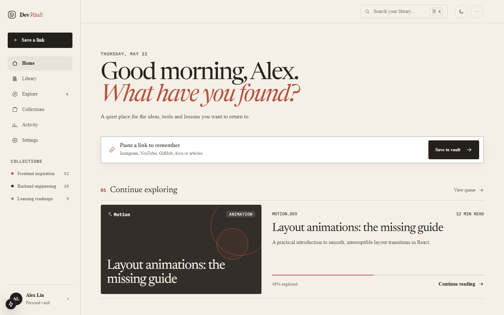
  <br><sub><code>HOME</code> — a greeting, one capture bar and the thing you were halfway through</sub>
</p>

<table>
  <tr>
    <td width="50%">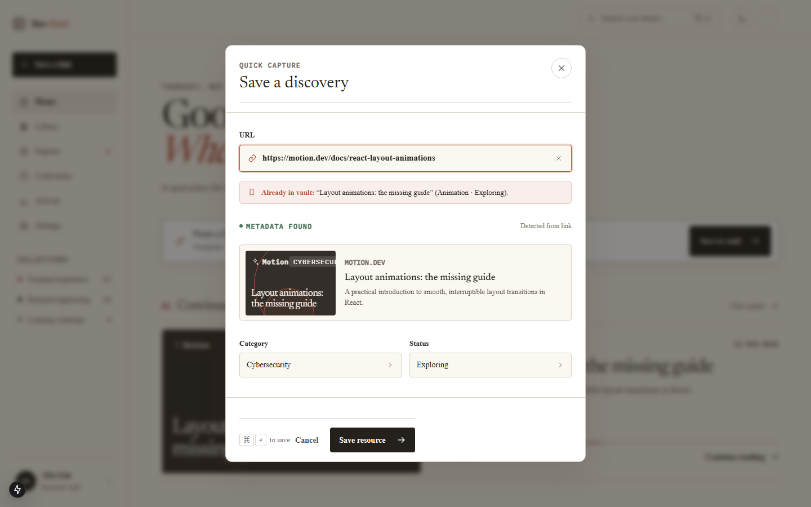<br><sub><code>QUICK CAPTURE</code> — metadata found, duplicate caught before it is saved</sub></td>
    <td width="50%">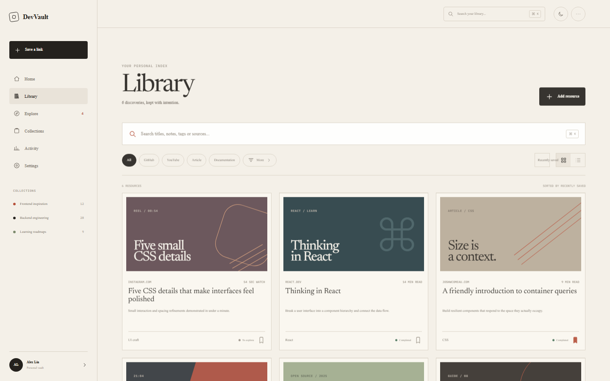<br><sub><code>LIBRARY</code> — search, source pills, categories and composable filters</sub></td>
  </tr>
  <tr>
    <td width="50%">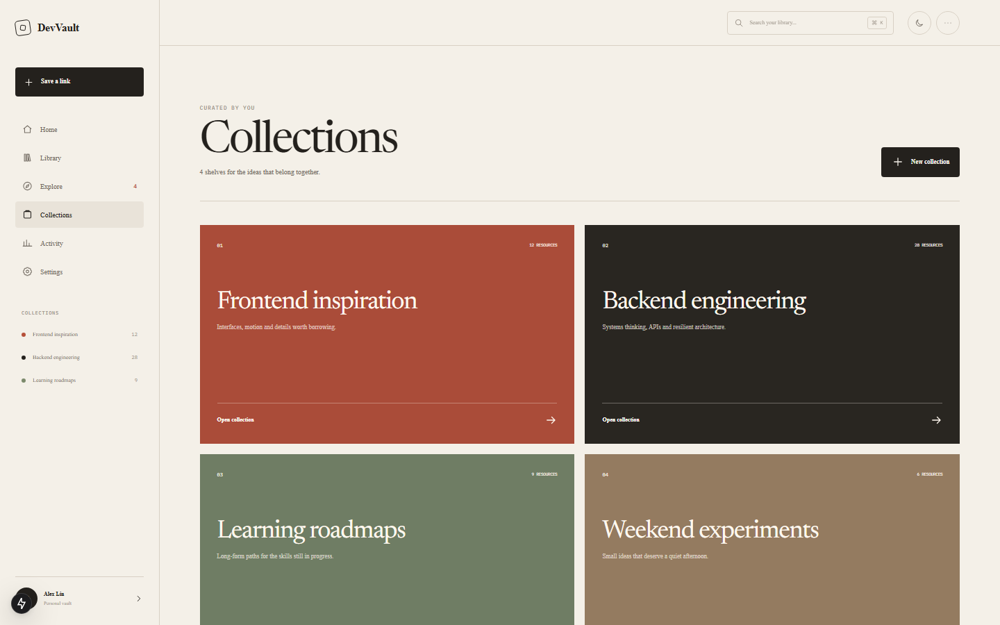<br><sub><code>COLLECTIONS</code> — curated shelves such as <i>Frontend inspiration</i> or <i>Backend engineering</i></sub></td>
    <td width="50%">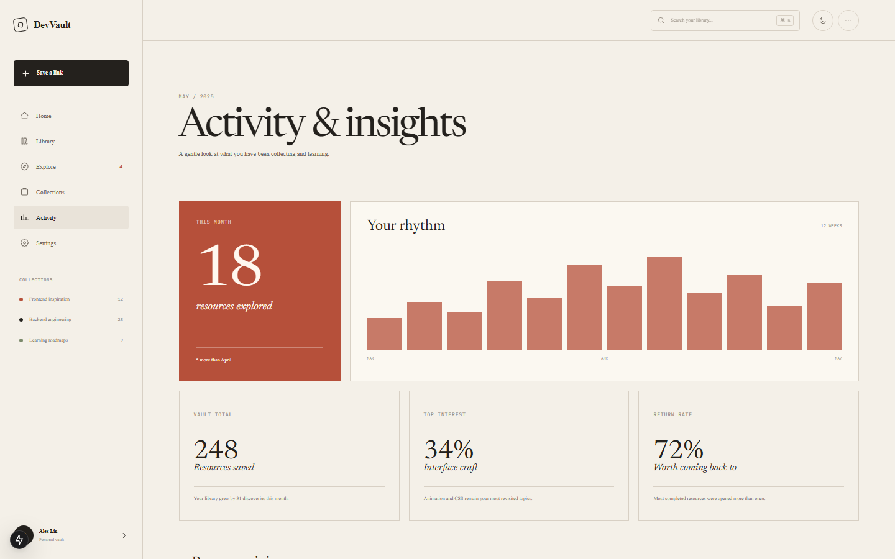<br><sub><code>ACTIVITY</code> — a timeline of captures, explorations and completions</sub></td>
  </tr>
</table>

<p align="center">
  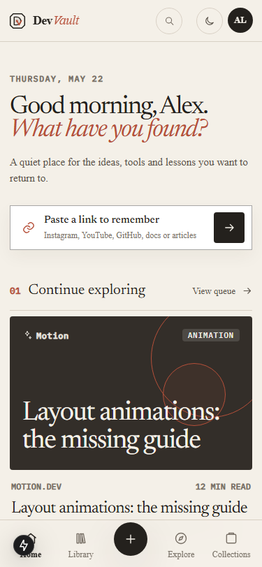&nbsp;
  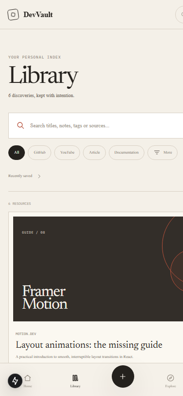&nbsp;
  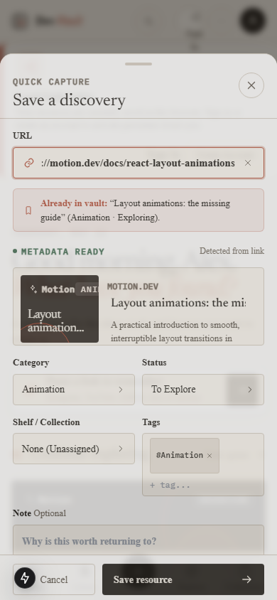&nbsp;
  
  <br><sub><code>MOBILE</code> — thumb-first navigation, a floating capture button and bottom-sheet filters</sub>
</p>

<details>
<summary><b>More rooms in the vault</b> &nbsp;<sub>(explore queue · settings · auth · responsive breakpoints)</sub></summary>
<br>

| | |
|:--:|:--:|
| 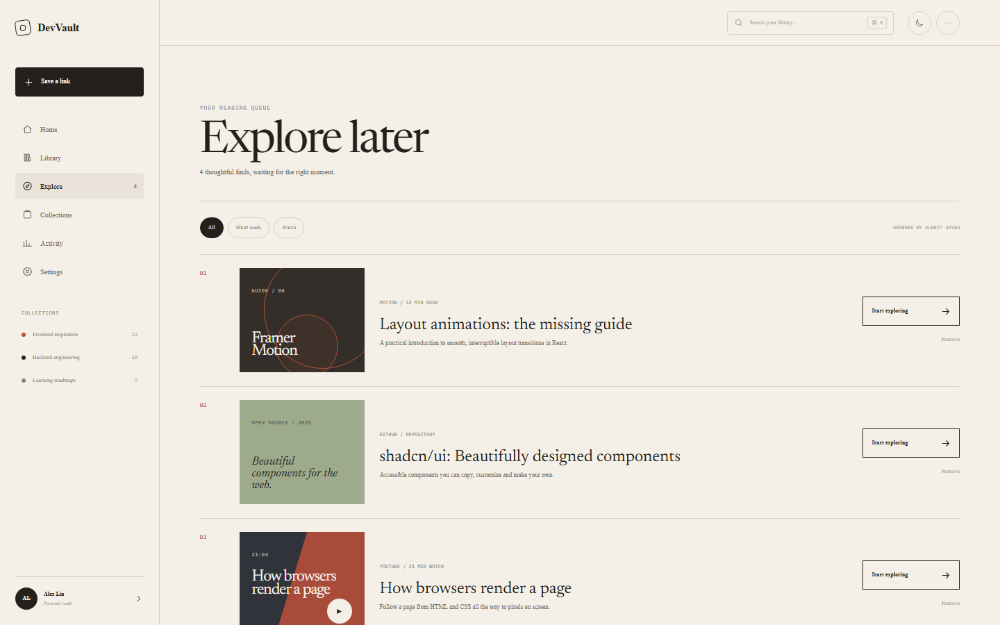 <br><sub>`EXPLORE LATER`: queue with progress</sub> | 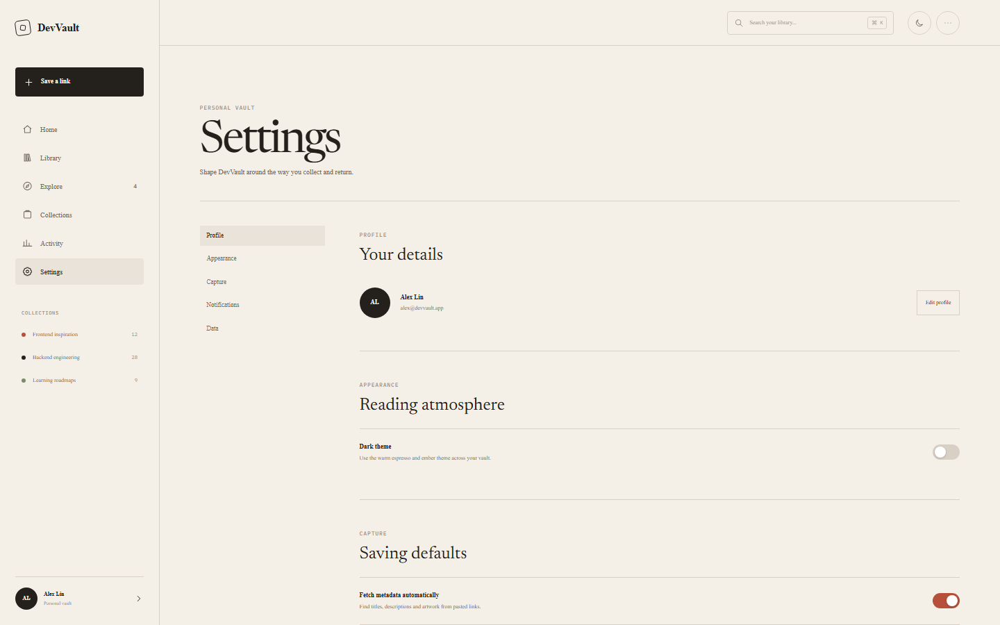 <br><sub>`SETTINGS`: profile, appearance, capture, data, shortcuts</sub> |
| 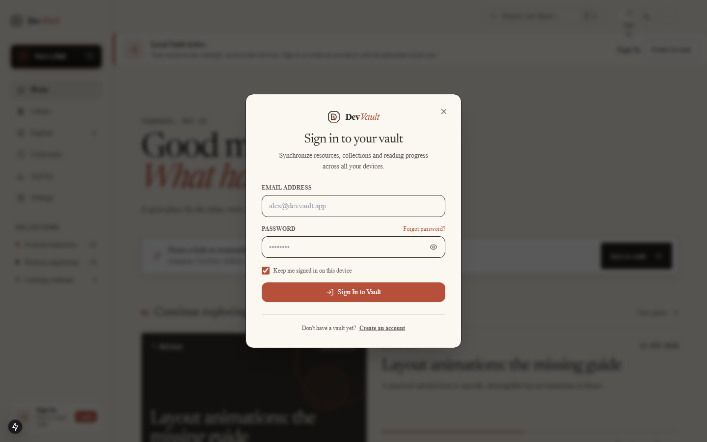 <br><sub>`AUTH`: sign in without leaving the page</sub> | 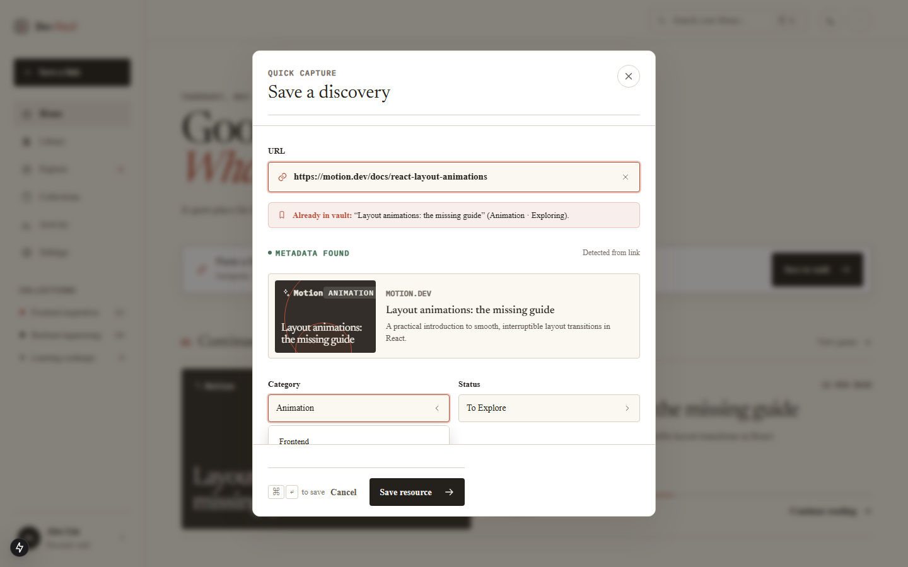 <br><sub>`CAPTURE`: categorize while you save</sub> |
| 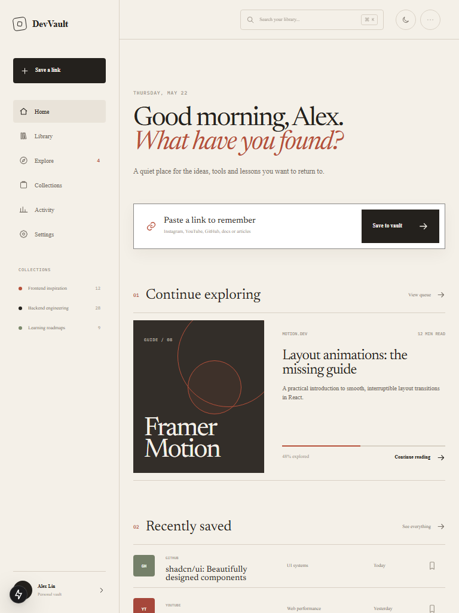 <br><sub>`768 px`</sub> | 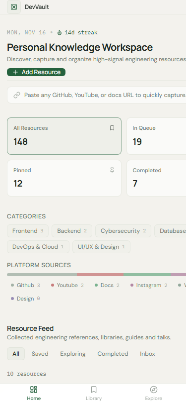 <br><sub>`375 px`</sub> |

</details>


<a id="features"></a>

## `03` · What's on the shelves

<table>
  <tr>
    <td width="50%" valign="top">
      <h4>🧲 &nbsp;Quick Capture</h4>
      Paste any link into the home bar or the modal (<kbd>⌘</kbd>/<kbd>Ctrl</kbd> + <kbd>Enter</kbd> saves it). DevVault detects the platform, fetches the title, author and thumbnail, suggests a category and <b>warns you when the link is already in your vault</b>.
    </td>
    <td width="50%" valign="top">
      <h4>🪄 &nbsp;Smart metadata</h4>
      Dedicated providers for <b>GitHub</b> (stars, forks, language), <b>YouTube</b> (videos, Shorts, live and embeds), <b>Instagram</b> (reels and carousels) and a universal Open Graph fallback for everything else.
    </td>
  </tr>
  <tr>
    <td valign="top">
      <h4>🔎 &nbsp;Global search</h4>
      <kbd>⌘</kbd> <kbd>K</kbd> from anywhere. Weighted Postgres full-text search ranks matches by title, then category and platform, then notes and description, then domain and URL. It also works fully offline in local mode.
    </td>
    <td valign="top">
      <h4>🎛️ &nbsp;Advanced filtering</h4>
      Combine source, category, status, collection, <b>multi-tag AND</b>, favorites, pinned items and date presets (<code>today</code> · <code>7d</code> · <code>30d</code> · <code>year</code>) with search. Filters open in a popover on desktop and a bottom sheet on mobile, and each one can be dismissed as a chip.
    </td>
  </tr>
  <tr>
    <td valign="top">
      <h4>🗂️ &nbsp;Collections &amp; tags</h4>
      Build curated shelves like <i>Frontend inspiration</i>, <i>Backend engineering</i> or <i>Learning roadmaps</i>. Free-form tags sit on top of eight categories, from Frontend to Cybersecurity to AI &amp; ML.
    </td>
    <td valign="top">
      <h4>🧭 &nbsp;Explore later</h4>
      Every resource moves through <code>Inbox → Saved → Exploring → Completed → Archived</code>. Progress bars show how far you got, and <i>Continue reading</i> takes you straight back.
    </td>
  </tr>
  <tr>
    <td valign="top">
      <h4>🔐 &nbsp;Accounts &amp; sync</h4>
      Email and password auth through Supabase, opened from a modal so you never lose your place. Data you saved before signing up <b>migrates from local storage to the cloud</b>, and duplicates are skipped.
    </td>
    <td valign="top">
      <h4>🌗 &nbsp;Two moods, one system</h4>
      A light <i>warm editorial parchment</i> theme and a dark <i>espresso &amp; ember</i> theme, both driven by CSS tokens and fully responsive from 360&nbsp;px phones to 1440&nbsp;px desktops.
    </td>
  </tr>
</table>


<a id="capture-engine"></a>

## `04` · The capture engine

<picture>
  <source media="(prefers-color-scheme: dark)" srcset="docs/readme/capture-engine-dark.svg">
  <source media="(prefers-color-scheme: light)" srcset="docs/readme/capture-engine-light.svg">
  
</picture>

Every capture calls a single route handler, `POST /api/metadata/extract`. A pasted URL is **untrusted input**, so the engine was built with that in mind:

| Layer | What it does | Where |
|:--|:--|:--|
| **URL validation** | Structural checks, scheme allow-list, blocks private, loopback and link-local ranges | `src/lib/metadata/url-validator.ts` |
| **SSRF-hardened fetch** | Undici agent with socket-level DNS interception and **connection IP pinning**, re-validates every redirect, at most 5 hops, a 6 s budget, a 1 MB streaming body cap and content-type checks | `src/lib/metadata/safe-fetch.ts` |
| **Cache** | Bounded LRU with URL canonicalization and a 1 h TTL | `src/lib/metadata/metadata-cache.ts` |
| **Rate limiter** | Sliding window of 30 requests per 60 s per identity, with automatic pruning | `src/lib/metadata/rate-limiter.ts` |
| **Providers** | Picked by priority: GitHub `30` → YouTube `20` → Instagram `15` → Website `0` | `src/lib/metadata/providers/` |
| **Merge** | Field-level merge: primary fields win, empty fields get enriched, nothing is ever overwritten with empty values | `src/lib/metadata/extractor.ts` |

> [!NOTE]
> oEmbed requests only go to a fixed allow-list of endpoints. Embedded HTML is kept as an inert string and never rendered, and `javascript:` and `data:` media URLs are rejected outright.


<a id="architecture"></a>

## `05` · Under the floorboards

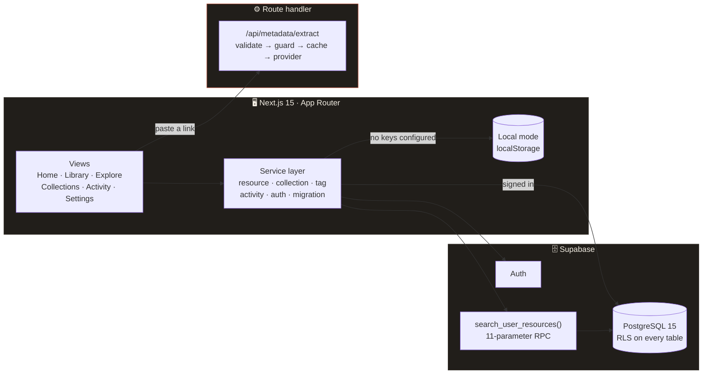

- **Repository and service pattern.** Views never call Supabase directly. Each service (`src/services/*`) decides at runtime whether to use Postgres or the local cache, so the whole app also works with **no backend at all**.
- **SQL is the source of truth.** Versioned migrations in `supabase/migrations/` define seven tables (`profiles`, `resources`, `collections`, `collection_resources`, `tags`, `resource_tags`, `activity_events`) plus triggers, indexes and **Row Level Security on 100 % of tables**.
- **Search lives in the database.** A generated, weighted `tsvector` column with a GIN index, case-insensitive helper indexes, and a `SECURITY INVOKER` RPC that scopes every query to `auth.uid()`.

<details>
<summary><b>Data model</b> &nbsp;<sub>(entity relationship diagram)</sub></summary>
<br>

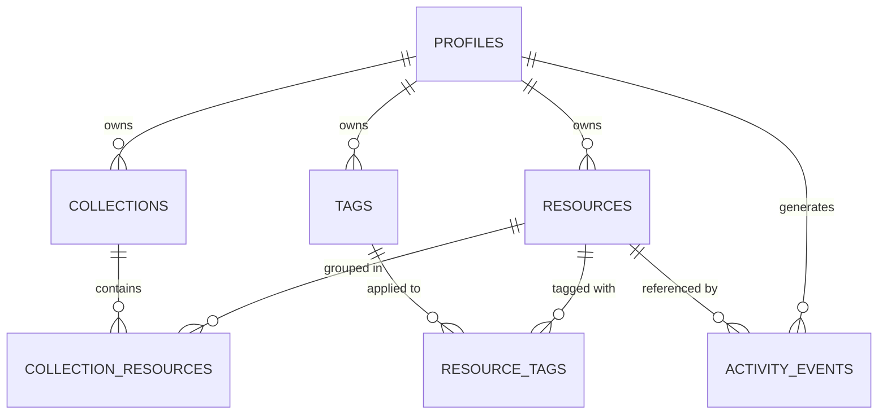

</details>


<a id="quickstart"></a>

## `06` · Open the vault locally


**You will need** Node.js 20 LTS or newer and npm. A Supabase project is optional.

```bash
git clone https://github.com/arman080325/DevVault.git
```

```bash
cd DevVault && npm install
```

```bash
npm run dev
```

Then open **http://localhost:3000** and paste your first link. 🎉

> [!TIP]
> **No Supabase keys? No problem.** DevVault notices placeholder or missing credentials and runs in **local mode**: resources, collections and settings are stored in your browser. When you connect Supabase later and sign in, the migration service offers to move that local data to the cloud.

<details>
<summary><b>Connect Supabase for cloud sync</b></summary>
<br>

1. Create a project at [supabase.com](https://supabase.com).
2. Copy the env template and fill in your project URL and **anon** key:

   ```bash
   cp .env.example .env.local
   ```

   | Variable | Purpose |
   |:--|:--|
   | `NEXT_PUBLIC_SUPABASE_URL` | Your project URL, e.g. `https://xyz.supabase.co` |
   | `NEXT_PUBLIC_SUPABASE_ANON_KEY` | Public anon key (safe in the browser *because* of RLS) |
   | `NEXT_PUBLIC_APP_ENV` | `development` or `production` |
   | `NEXT_PUBLIC_SITE_URL` | Base URL for auth redirects |
   | `YOUTUBE_API_KEY` *(optional, server only)* | Adds descriptions and publish dates to YouTube captures |

3. Apply the SQL in `supabase/migrations/` in numeric order (`001` → `008`) using the Supabase SQL editor or CLI.

> [!WARNING]
> Never put `SUPABASE_SERVICE_ROLE_KEY` or database passwords in a client-facing `.env` file. Every request is meant to go through Row Level Security with the anon key.

</details>

### Scripts

| Command | What it does |
|:--|:--|
| `npm run dev` | Start the dev server on `localhost:3000` |
| `npm run build` | Create a production build |
| `npm run start` | Serve the production build |
| `npm run lint` | Run ESLint (`next/core-web-vitals`) |
| `npm run type-check` | Run a strict `tsc --noEmit` pass |

The `scripts/` folder contains the phase verification suites (`verify-phase-*.js`) used to sign off each milestone, covering search, filters, metadata providers, auth and responsive layouts.

### Keyboard

| Keys | Action |
|:--|:--|
| <kbd>⌘</kbd> <kbd>K</kbd> &nbsp;/&nbsp; <kbd>Ctrl</kbd> <kbd>K</kbd> | Search your library from anywhere |
| <kbd>⌘</kbd> <kbd>↵</kbd> &nbsp;/&nbsp; <kbd>Ctrl</kbd> <kbd>↵</kbd> | Save the resource in Quick Capture |
| <kbd>Enter</kbd> &nbsp;/&nbsp; <kbd>,</kbd> | Add a tag while capturing |
| <kbd>Esc</kbd> | Close a modal, drawer or sheet |


<a id="floor-plan"></a>

## `07` · Floor plan

```text
DevVault/
├── src/
│   ├── app/
│   │   ├── api/metadata/extract/   ← the capture engine's single entry point
│   │   ├── layout.tsx · page.tsx   ← app shell, ?tab= navigation
│   │   └── globals.css             ← parchment & espresso design tokens
│   ├── components/
│   │   ├── views/                  ← home · library · explore · collections · activity · settings
│   │   ├── modals/                 ← quick capture, resource detail drawer
│   │   ├── auth/                   ← discoverable auth modal
│   │   ├── layout/                 ← sidebar, top nav, mobile nav, brand
│   │   ├── dashboard/ · resources/ ← cards, grids, stats, command palette
│   │   └── ui/ · shared/           ← Radix-based primitives, tag pills, theme toggle
│   ├── services/                   ← resource · collection · tag · activity · auth · migration
│   ├── lib/
│   │   ├── metadata/               ← validator, safe-fetch, cache, rate limiter, providers
│   │   ├── search/                 ← search matcher (local mode parity)
│   │   └── supabase/               ← browser & server clients, generated types
│   ├── config/ · types/ · data/    ← platforms, navigation, domain models, fixtures
├── supabase/migrations/            ← 001 → 008: schema, RLS, search, filtering
├── docs/                           ← blueprint, architecture, phase reports, screenshots
│   └── readme/                     ← the animated SVG artwork on this page
├── scripts/                        ← verification suites
└── public/                         ← manifest, vault icon
```


<a id="design-language"></a>

## `08` · Design language

<picture>
  <source media="(prefers-color-scheme: dark)" srcset="docs/readme/design-language-dark.svg">
  <source media="(prefers-color-scheme: light)" srcset="docs/readme/design-language-light.svg">
  
</picture>

- **Editorial, not "dashboardy".** Large Newsreader headlines with an italic accent line (*"What have you found?"*), numbered section labels like `01 Continue exploring` and generous whitespace.
- **One accent, used sparingly.** Rust `#B6503A` on parchment and ember `#DA755C` on espresso. It marks only what matters: the active item, progress and the next action.
- **Motion with manners.** Framer Motion handles layout transitions and micro-interactions and respects `prefers-reduced-motion`. So does every animated figure in this README.
- **Accessible by default.** Radix primitives, visible focus rings, touch targets of at least 44 px and keyboard shortcuts for every primary action.


<a id="roadmap"></a>

## `09` · The road ahead

| | Phase | Highlights |
|:--:|:--|:--|
| ✅ | **01 · Foundation** | Next.js 15 + strict TS, design tokens, responsive shell, dashboard, quick capture |
| ✅ | **02.1 · Auth** | Supabase auth, discoverable modal, session management, profile settings |
| ✅ | **02.2 · Persistence** | Versioned SQL migrations, RLS everywhere, local-to-cloud migration |
| ✅ | **02.3 · Smart metadata** | SSRF-hardened engine, GitHub / YouTube / Instagram / Open Graph providers |
| ✅ | **02.4 · Search & filters** | Weighted full-text search, 11-dimension filtering RPC, mobile filter sheet |
| 🔜 | **03 · Workspaces** | Richer collections, drag-and-drop organization, deeper reading queue |
| 🔜 | **04 · Command palette** | Fuzzy, keyboard-first navigation and actions |
| 🔜 | **05 · Insights** | Capture streaks, topic mastery, Markdown / JSON export |
| 🔜 | **06 · PWA** | Installable app, offline reading of cached resources |
| 🔜 | **07 · Browser extension** | One-click capture from any tab |

Every milestone is documented in [`docs/`](docs/). Start with the [Project Blueprint](docs/PROJECT_BLUEPRINT.md), the [Phase 02 Architecture](docs/PHASE_02_ARCHITECTURE.md) and the [Development Log](docs/DEVELOPMENT_LOG.md).


<a id="contributing"></a>

## `10` · Contributing

1. Branch from `main` using the `feat/*`, `fix/*` or `docs/*` prefixes.
2. Use [Conventional Commits](https://www.conventionalcommits.org/) (`feat:`, `fix:`, `docs:`, `refactor:` and so on).
3. Before opening a PR, run `npm run lint`, `npm run type-check` and `npm run build`.
4. For UI changes, include desktop and mobile screenshots in **both** themes.

<a id="license"></a>

## License

Released under the **MIT** license. © 2026 DevVault.

<br>

<picture>
  <source media="(prefers-color-scheme: dark)" srcset="docs/readme/footer-dark.svg">
  <source media="(prefers-color-scheme: light)" srcset="docs/readme/footer-light.svg">
  
</picture>

<p align="right"><a href="#top"><sub>↑ back to top</sub></a></p>
