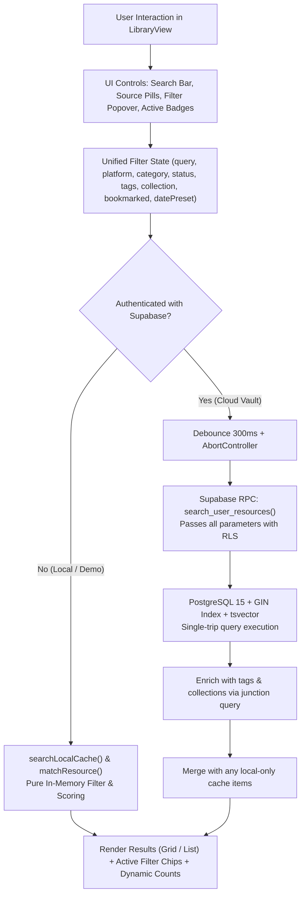

# DevVault — Phase 02.4.2: Advanced Filtering Architecture Audit

**Execution Date:** November 19, 2026  
**Status:** Audit & Plan Complete (Awaiting User Authorization)  
**Target Git Branch:** `feat/phase-02-4-advanced-filtering`  
**Base Commit Checkpoint:** `25a58b0e9d01e3a9ce4f4775e2af6d1b597e00cf` (`feat(search): implement global resource search`)  
**Parent Commit:** `ae0ec11fc1a4fba5efe0702ef1cff44d3fda0fa6` (`feat(metadata): integrate platform extraction with quick capture`)  

---

## 1. Executive Summary & Audit Overview

Following the successful implementation, live Supabase deployment, and verification of Phase 02.4.1 (Global Search), DevVault now possesses:
1. A generated `search_vector tsvector` column with a GIN index on `public.resources`.
2. A high-performance PostgreSQL RPC function `search_user_resources` enforcing Row Level Security (RLS) via `SECURITY INVOKER`.
3. A normalized multi-field search matcher (`src/lib/search/search-matcher.ts`) covering Title, Description, Personal Notes, URLs, Platform, Category, Tags, and Collections.
4. Seamless in-browser debouncing, live visual status feedback, and zero-leakage local storage fallback.

The objective of **Phase 02.4.2 (Advanced Filtering)** is to enable users to effortlessly combine multidimensional filters with global text search across both large cloud vaults and offline local storage.

This document details the architectural inspection of existing systems, evaluates all 7 requested filtering dimensions against the underlying schema, formulates a unified criteria model, designs the database RPC evolution strategy, and establishes the UI/mobile interaction and verification specifications.

---

## 2. Existing Implementation Findings

### 2.1 Inspection of Codebase & Services

| Component / Layer | File Path | Existing Architecture & Capabilities |
|---|---|---|
| **Resource Library View** | [`src/components/views/library-view.tsx`](file:///c:/Users/arman/Downloads/Projects/DevVault/src/components/views/library-view.tsx) | Renders search bar, horizontal source pills (`"All"`, `"GitHub"`, `"YouTube"`, `"Article"`, `"Documentation"`), `"More"` dropdown (`"Instagram"`, `"Motion"`), sort selector (`"recent"`, `"oldest"`, `"title"`), view toggle (`"grid"` vs `"list"`), and result counter. Debounces search requests (300ms) with `AbortController` cancellation. |
| **Search Matching Engine** | [`src/lib/search/search-matcher.ts`](file:///c:/Users/arman/Downloads/Projects/DevVault/src/lib/search/search-matcher.ts) | Implements tokenization, punctuation preservation, URL segment extraction, and weighted relevance scoring. Accepts `SearchMatchOptions` supporting single `platform`, `category`, `status`, `collection`, and single `tag`. |
| **Persistence & Search Service** | [`src/services/resource-service.ts`](file:///c:/Users/arman/Downloads/Projects/DevVault/src/services/resource-service.ts) | Implements `searchResources(userId, criteria)` and `searchLocalCache(criteria)`. Invokes `search_user_resources` RPC with `{ search_query, filter_platform, filter_category, filter_status }`. Resolves collection and tag matches client-side in JS memory post-RPC. |
| **Application Controller** | [`src/app/page.tsx`](file:///c:/Users/arman/Downloads/Projects/DevVault/src/app/page.tsx) | Holds global state for `resources`, `collections`, `searchQuery`, `authUser`, and `authSession`. Mounts `LibraryView` passing `resources`, `query`, `onQueryChange`, and `userId`. *(Note: `collections` is currently not passed down to `LibraryView`).* |
| **Data Types & Models** | [`src/data/figmaResources.ts`](file:///c:/Users/arman/Downloads/Projects/DevVault/src/data/figmaResources.ts), [`src/lib/supabase/types.ts`](file:///c:/Users/arman/Downloads/Projects/DevVault/src/lib/supabase/types.ts) | Defines `FigmaResource` and database `ResourceRow`, `CollectionRow`, `TagRow`. |
| **Database Migrations** | [`supabase/migrations/002_create_resources.sql`](file:///c:/Users/arman/Downloads/Projects/DevVault/supabase/migrations/002_create_resources.sql), [`007_search_indexes.sql`](file:///c:/Users/arman/Downloads/Projects/DevVault/supabase/migrations/007_search_indexes.sql) | Table `public.resources` includes columns `platform`, `category`, `status`, `is_pinned`, `is_favorite`, `created_at`, `updated_at`, `explored_at`, and `search_vector`. Relational tables `collection_resources` and `resource_tags` manage associations. |

---

## 3. Existing Capabilities vs. Missing Capabilities

### 3.1 Existing Capabilities
- **Platform / Source Filtering:** Fully functional in UI via horizontal pills and `"More"` dropdown. Passed to RPC via `filter_platform`.
- **Text Search Across Multiple Fields:** Full-text matching across Title, Description, Notes, URLs, and relational names via generated `search_vector` and GIN index.
- **Sorting Options:** Client-side sorting by `"recent"`, `"oldest"`, and `"title"` (A-Z).
- **View Toggles:** Responsive Grid vs. Compact List layout.
- **Local Fallback:** Instant offline search and filtering using local cache when unauthenticated.
- **Single-field Status & Category Filtering in Database:** Supported by `search_user_resources` RPC (`filter_category`, `filter_status`), but not yet exposed in the `LibraryView` UI.

### 3.2 Missing Capabilities (Gap Analysis)
1. **Multi-Tag Selection:** Currently, `SearchResourceCriteria` and `SearchMatchOptions` only accept a single string `tag?: string`. The database RPC function has no parameter for tag filtering. Users cannot filter resources by multiple tags (e.g. `['React', 'Physics']`).
2. **Collection / Shelf Filtering:** `search_user_resources` has no `filter_collection` parameter. Collection filtering currently happens in JavaScript memory *after* results are fetched, preventing database-level pagination and filtering. In the UI, there is no collection dropdown/filter in `LibraryView`.
3. **Date Added & Date Ranges:** Neither the UI, the client service, the TypeScript matcher, nor the database RPC support date filtering (e.g., `"Past 7 days"`, `"Past 30 days"`, or custom ranges).
4. **Favorites / Pinned (Bookmarked) Filter:** Although `is_pinned` and `is_favorite` are indexed in PostgreSQL (`idx_resources_user_pinned`, `idx_resources_user_favorite`), there is no UI filter or RPC parameter to isolate bookmarked items.
5. **Combined Multi-Filter UI Controls:** The current UI only renders platform/source tabs. It lacks a unified, cohesive filter drawer or popover for combining Category + Status + Tags + Collection + Dates.
6. **Active Filter Indicators & Dismissal Chips:** When multiple filters are active, the user has no visual badge row displaying active filters or one-click dismissal chips.
7. **Reset / Clear-All Action:** Clearing is currently restricted to clearing the text input or resetting source to `"All"`. There is no global reset for compound filter combinations.

---

## 4. Evaluation of Proposed Filtering Dimensions

We evaluated all 7 proposed filtering dimensions against the existing PostgreSQL schema (`002_create_resources.sql`, `003_create_collections.sql`, `004_create_tags.sql`, `007_search_indexes.sql`) and the client model:

| # | Dimension | Database Column / Relationship | Existing DB Index | Supported by Current RPC? | Recommendation |
|:---:|---|---|---|:---:|---|
| **1** | **Platform / Source** | `resources.platform TEXT` | `idx_resources_user_platform` | **Yes** (`filter_platform`) | Retain existing pill bar; include in unified criteria. |
| **2** | **Category** | `resources.category TEXT` | `idx_resources_user_category` | **Yes** (`filter_category`) | Expose in UI filter popover; map to unified criteria. |
| **3** | **Resource Status** | `resources.status TEXT` | `idx_resources_user_status` | **Yes** (`filter_status`) | Expose in UI filter popover (`"To explore"`, `"Exploring"`, `"Completed"`). |
| **4** | **Tags (Single & Multi)** | `public.resource_tags` &rarr; `public.tags` | `idx_res_tags_tag`, `idx_tags_user_id` | **No** (Only in text search) | Add `filter_tags TEXT[]` to RPC with AND-semantics; support chip selection in UI. |
| **5** | **Collection / Shelf** | `public.collection_resources` &rarr; `public.collections` | `idx_col_res_collection`, `idx_col_res_resource` | **No** (Only in text search) | Add `filter_collection TEXT` to RPC (matches name or UUID); pass `collections` to `LibraryView`. |
| **6** | **Date Added / Range** | `resources.created_at TIMESTAMPTZ` | `idx_resources_created_at` | **No** | Add `filter_date_from` and `filter_date_to` to RPC; provide presets (`"Past 7 days"`, `"Past 30 days"`, `"All time"`) in UI. |
| **7** | **Favorites & Pinned** | `resources.is_favorite`, `resources.is_pinned` | `idx_resources_user_favorite`, `idx_resources_user_pinned` | **No** | Add `filter_favorite BOOLEAN` and `filter_pinned BOOLEAN` to RPC; provide `"Bookmarked"` toggle in UI. |

---

## 5. Unified Criteria Architecture & Data Flow

Rather than building a secondary or parallel filtering pipeline, **all search and filtering dimensions must unite under one comprehensive criteria interface**. This preserves existing global search semantics, full-text ranking, debouncing, and local/demo mode.

### 5.1 Unified TypeScript Criteria Model
In [`src/services/resource-service.ts`](file:///c:/Users/arman/Downloads/Projects/DevVault/src/services/resource-service.ts) and [`src/lib/search/search-matcher.ts`](file:///c:/Users/arman/Downloads/Projects/DevVault/src/lib/search/search-matcher.ts):

```typescript
export interface SearchResourceCriteria {
  // Free-text query
  query?: string;

  // Single-value categorical filters
  platform?: string;    // e.g. "GitHub", "YouTube", "Website", "All"
  category?: string;    // e.g. "Frontend", "Databases", "All"
  status?: string;      // e.g. "To explore", "Exploring", "Completed", "All"
  collection?: string;  // Collection name or UUID, "All"

  // Relational & multi-value filters
  tag?: string;         // Single tag (backwards compatibility)
  tags?: string[];      // Multi-select tags (AND-matching)

  // Flags & state
  favorite?: boolean;
  pinned?: boolean;
  bookmarked?: boolean; // Matches favorite OR pinned

  // Date boundaries
  dateFrom?: string;    // ISO 8601 string or Date
  dateTo?: string;      // ISO 8601 string or Date
  datePreset?: "all" | "today" | "7d" | "30d" | "year";

  // In-flight abort signal
  signal?: AbortSignal;
}
```

### 5.2 Criteria Lifecycle & Flow Diagram



---

## 6. Database & RPC Evolution Strategy

### 6.1 Database Migration `008_advanced_filtering.sql`
The existing `search_user_resources` function in `supabase/migrations/007_search_indexes.sql` will be updated via a non-breaking, backwards-compatible migration. Because all new parameters provide `DEFAULT NULL`, existing client calls remain valid.

```sql
-- Migration: 008_advanced_filtering.sql
-- Extend search_user_resources RPC to support tags, collections, dates, and bookmarks

CREATE OR REPLACE FUNCTION public.search_user_resources(
  search_query TEXT DEFAULT NULL,
  filter_platform TEXT DEFAULT NULL,
  filter_category TEXT DEFAULT NULL,
  filter_status TEXT DEFAULT NULL,
  filter_collection TEXT DEFAULT NULL,
  filter_tags TEXT[] DEFAULT NULL,
  filter_favorite BOOLEAN DEFAULT NULL,
  filter_pinned BOOLEAN DEFAULT NULL,
  filter_date_from TIMESTAMPTZ DEFAULT NULL,
  filter_date_to TIMESTAMPTZ DEFAULT NULL
)
RETURNS TABLE (
  id UUID,
  user_id UUID,
  title TEXT,
  original_url TEXT,
  normalized_url TEXT,
  description TEXT,
  thumbnail_url TEXT,
  source_domain TEXT,
  platform TEXT,
  category TEXT,
  status TEXT,
  personal_notes TEXT,
  read_time TEXT,
  author_name TEXT,
  is_pinned BOOLEAN,
  is_favorite BOOLEAN,
  progress INTEGER,
  created_at TIMESTAMPTZ,
  updated_at TIMESTAMPTZ,
  explored_at TIMESTAMPTZ,
  rank REAL
)
LANGUAGE sql
SECURITY INVOKER
STABLE
AS $$
  SELECT
    r.id,
    r.user_id,
    r.title,
    r.original_url,
    r.normalized_url,
    r.description,
    r.thumbnail_url,
    r.source_domain,
    r.platform,
    r.category,
    r.status,
    r.personal_notes,
    r.read_time,
    r.author_name,
    r.is_pinned,
    r.is_favorite,
    r.progress,
    r.created_at,
    r.updated_at,
    r.explored_at,
    CASE
      WHEN search_query IS NOT NULL AND trim(search_query) <> ''
      THEN ts_rank_cd(r.search_vector, websearch_to_tsquery('english', search_query))
      ELSE 0.0::REAL
    END AS rank
  FROM public.resources r
  WHERE r.user_id = auth.uid()
    -- Direct column filters
    AND (filter_platform IS NULL OR filter_platform = 'All' OR r.platform ILIKE filter_platform)
    AND (filter_category IS NULL OR filter_category = 'All' OR r.category ILIKE filter_category)
    AND (filter_status IS NULL OR filter_status = 'All' OR r.status ILIKE filter_status)
    AND (filter_favorite IS NULL OR r.is_favorite = filter_favorite)
    AND (filter_pinned IS NULL OR r.is_pinned = filter_pinned)
    -- Date boundaries
    AND (filter_date_from IS NULL OR r.created_at >= filter_date_from)
    AND (filter_date_to IS NULL OR r.created_at <= filter_date_to)
    -- Relational Collection Filter
    AND (
      filter_collection IS NULL
      OR filter_collection = 'All'
      OR EXISTS (
        SELECT 1
        FROM public.collection_resources cr
        JOIN public.collections c ON c.id = cr.collection_id
        WHERE cr.resource_id = r.id
          AND c.user_id = auth.uid()
          AND (c.name ILIKE filter_collection OR c.id::text = filter_collection)
      )
    )
    -- Relational Multi-Tag Filter (AND semantics: resource must have all specified tags)
    AND (
      filter_tags IS NULL
      OR cardinality(filter_tags) = 0
      OR (
        SELECT count(DISTINCT lower(t.name))
        FROM public.resource_tags rt
        JOIN public.tags t ON t.id = rt.tag_id
        WHERE rt.resource_id = r.id
          AND t.user_id = auth.uid()
          AND lower(t.name) = ANY(
            SELECT lower(unnest(filter_tags))
          )
      ) = cardinality(filter_tags)
    )
    -- Free-Text & Full-Text Search
    AND (
      search_query IS NULL
      OR trim(search_query) = ''
      OR r.search_vector @@ websearch_to_tsquery('english', search_query)
      OR r.title ILIKE '%' || trim(search_query) || '%'
      OR r.original_url ILIKE '%' || trim(search_query) || '%'
      OR r.personal_notes ILIKE '%' || trim(search_query) || '%'
      OR EXISTS (
        SELECT 1
        FROM public.resource_tags rt
        JOIN public.tags t ON t.id = rt.tag_id
        WHERE rt.resource_id = r.id
          AND t.user_id = auth.uid()
          AND t.name ILIKE '%' || trim(search_query) || '%'
      )
      OR EXISTS (
        SELECT 1
        FROM public.collection_resources cr
        JOIN public.collections c ON c.id = cr.collection_id
        WHERE cr.resource_id = r.id
          AND c.user_id = auth.uid()
          AND c.name ILIKE '%' || trim(search_query) || '%'
      )
    )
  ORDER BY
    CASE
      WHEN search_query IS NOT NULL AND trim(search_query) <> ''
      THEN ts_rank_cd(r.search_vector, websearch_to_tsquery('english', search_query))
      ELSE 0.0::REAL
    END DESC,
    r.created_at DESC;
$$;
```

### 6.2 Service-Level Optimization in `resource-service.ts`
Because `search_user_resources` handles collections, tags, dates, and bookmarks at the SQL engine level:
1. Client-side JS filtering in `resource-service.ts` becomes obsolete for cloud queries.
2. The junction query only needs to load metadata for the pre-filtered resource IDs to populate badges on the cards.
3. The PostgREST fallback query is updated to mirror the identical criteria parameters.

---

## 7. UI & UX Integration Plan

### 7.1 Preserving Figma Aesthetic
The approved Figma aesthetic relies on warm parchment (`#fcfbf7`), espresso ink (`#181614`), quiet hairline borders (`var(--rule)`), and restrained terracotta rust accents (`var(--accent)`). The advanced filter controls must feel integral to this editorial language, not an added-on software dashboard.

### 7.2 Component Architecture & Layout

1. **Enhanced Filter Toolbar (`.library-tools`):**
   - Retain the primary horizontal source pills: `All`, `GitHub`, `YouTube`, `Article`, `Documentation`.
   - Right adjacent to the pills, add a tactile **`Filters` Trigger Button**:
     - Includes icon (`Icon name="filter"`).
     - Renders an active count badge when filters are applied (e.g., `Filters (3)`).
     - Visual active state: rust border and subtle warm background when any secondary filter is engaged.

2. **Advanced Filter Popover (`.filter-popover`):**
   - Triggered by the `Filters` button.
   - Built with the existing `.dropdown-popover` architecture with clean sections:
     - **Category Section:** Compact chip/pill selector with common categories (`All`, `Frontend`, `Architecture`, `Databases`, `UI systems`, `Animation`, `Web performance`).
     - **Status Section:** Pill selector (`All`, `To explore`, `Exploring`, `Completed`).
     - **Collection Shelf Section:** Dropdown selector populated from user's active collections.
     - **Tags Section:** Multi-select tag chips (`TagPill`) with active check states.
     - **Bookmarked / Pinned:** Quick toggle chip (`All`, `Pinned`, `Favorites`).
     - **Date Added Section:** Preset selector (`All time`, `Past 7 days`, `Past 30 days`, `This year`).
     - **Footer Actions:** `"Reset filters"` (text trigger) and `"Done"` (solid pill trigger).

3. **Active Filters Badge Row (`.active-filters-bar`):**
   - Rendered directly below `.library-tools` whenever active secondary filters or search queries are present.
   - Displays individual dismissible chips:
     - `Category: Frontend` &times;
     - `Status: To explore` &times;
     - `#React` &times;
     - `Collection: Design Systems` &times;
     - `Bookmarked` &times;
     - `Past 7 days` &times;
   - Clicking &times; removes that specific filter and re-evaluates the query.
   - Includes a quiet `"Clear all"` link that resets all filters back to default.

4. **Dynamic Live Result Counter:**
   - Result label automatically indicates compound filtering:
     - When filtered: `Showing 4 of 28 resources` + `Sorted by recently saved`.

5. **Comprehensive Empty State:**
   - When query + filters yield 0 results:
     - Distinct empty state headline: `Nothing found matching active criteria`.
     - Subtitle detailing active constraints (e.g. `No "Completed" items tagged #React in "Backend Lab"`).
     - Clear CTA: `Reset all filters`.

---

## 8. Mobile Resource Library Interaction Plan

### 8.1 Viewport Adaptations (< 768px)
- **Horizontal Scroll for Primary Pills:** Keep `.filters` horizontally scrollable with smooth touch momentum and fade mask.
- **Filter Trigger Access:** The `Filters` button is pinned prominently on the toolbar next to the sort button.
- **Slide-Up Bottom Sheet:** On mobile, clicking `Filters` smoothly animates a bottom drawer sheet (`.filter-drawer-mobile`) rather than a floating popover.
- **Touch Targets:** All interactive filter pills and checkboxes meet the minimum 44px touch-target standard.
- **Dismissal & Gestures:** Supports backdrop tap dismiss, swipe-down gesture, and hardware/virtual Back/Escape key handling.
- **Scroll Containment:** Body scroll is locked while the filter sheet is open.

---

## 9. Local / Demo Mode Fallback Strategy

For unauthenticated guests or offline operation:
1. `SearchMatchOptions` in `src/lib/search/search-matcher.ts` is expanded to accept the full criteria set: `tags?: string[]`, `favorite?: boolean`, `pinned?: boolean`, `dateFrom?: string`, `dateTo?: string`.
2. `matchResource()` applies pure in-memory evaluation:
   - Tags: `tags.every(t => resource.tags?.includes(t))`.
   - Collections: `resource.collection === criteria.collection`.
   - Category / Status / Platform: case-insensitive equality checks.
   - Bookmarked: `Boolean(resource.pinned || resource.favorite) === criteria.bookmarked`.
   - Date: parsed from `resource.saved` or ISO string.
3. Offline users experience identical multi-filter responsiveness and instantaneous UI updates without throwing network errors.

---

## 10. Multi-User Row Level Security (RLS) Considerations

1. **Security Invoker Isolation:** Migration `008` retains `SECURITY INVOKER` and explicit `WHERE r.user_id = auth.uid()`.
2. **Relational Subquery Scoping:**
   - Collection checks strictly include `AND c.user_id = auth.uid()`.
   - Tag checks strictly include `AND t.user_id = auth.uid()`.
   - Even if an attacker supplies a valid UUID belonging to another user in `filter_collection` or `filter_tags`, PostgreSQL's RLS and explicit user scoping will return zero rows.
3. **Parameter Sanitization:** All text inputs are parameterized in the SQL function signature, eliminating SQL injection vectors.

---

## 11. Verification & Test Plan

A dedicated automated test suite (`scripts/verify-phase-02-4-2-filters.js`) will verify:

1. **Unit Matching Engine Tests:**
   - Multi-tag AND-semantics matching.
   - Category, status, platform, collection combinations.
   - Pinned/favorite/bookmarked filtering.
   - Date preset calculation and range boundaries.
   - Compound combinations: Query + Platform + Category + Status + Multi-tags + Collection.
2. **Database Migration & RPC Verification:**
   - Safe migration application in Supabase.
   - Backwards compatibility with 4-parameter calls.
   - 10-parameter full-criteria invocation.
   - Multi-tenant RLS isolation checks (anon returns 0 rows; cross-user returns 0 rows).
3. **Headless Chrome CDP End-to-End Tests:**
   - Desktop and mobile viewport testing (1440px, 375px).
   - Filter Popover opening, selecting Category, Status, Tags, Collections.
   - Live network interception confirming `search_user_resources` receives correct RPC payload.
   - Active filter badges display and individual dismissal via &times;.
   - `"Clear all"` reset button restoring complete library.
   - Empty state verification when impossible filter combinations are applied.
   - Visual screenshot captures in light and dark modes.

---

## 12. Exact Implementation Sequence

Once approved, implementation will proceed through the following phased steps:

```
[Step 1: Criteria & Matcher Engine]
  ├── Update SearchMatchOptions & matchResource in src/lib/search/search-matcher.ts
  └── Support multi-tags, collections, bookmarks, and dates in searchResources()

[Step 2: Database Migration 008]
  ├── Author supabase/migrations/008_advanced_filtering.sql
  ├── Support 10-parameter search_user_resources with SECURITY INVOKER
  └── Verify backwards compatibility and RLS

[Step 3: Service Layer Integration]
  ├── Update SearchResourceCriteria in src/services/resource-service.ts
  ├── Update searchResources() RPC call with new filter payload
  └── Update PostgREST fallback query to support full criteria

[Step 4: UI Components & Popover]
  ├── Pass collections to LibraryView in src/app/page.tsx
  ├── Create FilterPopover / Drawer controls in src/components/views/library-view.tsx
  ├── Build ActiveFiltersBar with dismissal chips
  └── Add CSS styles in src/app/globals.css (Figma parchment/espresso)

[Step 5: Automated Verification & Documentation]
  ├── Run scripts/verify-phase-02-4-2-filters.js
  ├── Capture desktop/mobile light/dark screenshots
  └── Produce PHASE_02_4_2_FILTER_REPORT.md
```
