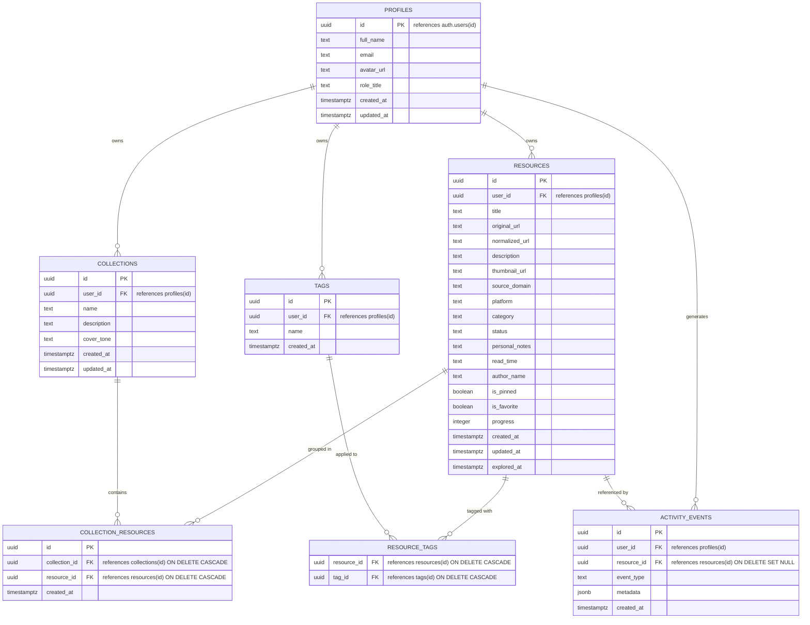
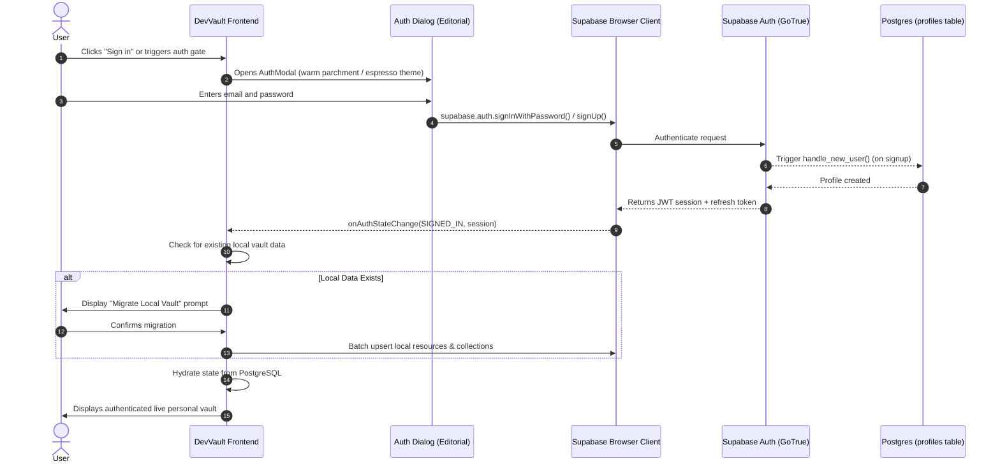

# DevVault — Phase 02 Architecture & Backend Blueprint
## Persistent Knowledge Management with Supabase, PostgreSQL & Row Level Security

**Date:** November 18, 2026  
**Status:** Approved Architectural Specification  
**Working Branch:** `feat/phase-02-database-backend`  
**Target Repository:** `https://github.com/arman080325/DevVault.git`

---

## 1. Executive Summary & Codebase Audit Findings

Following a comprehensive audit of the DevVault repository at the approved frontend baseline (HEAD `e8da571`), this architecture blueprint establishes the production backend foundation. DevVault transforms from an in-memory client prototype into a multi-session, secure, and persistently synchronized developer knowledge management platform.

### Codebase Audit Summary

| Architectural Vector | Existing Implementation | Phase 02 Target |
|---|---|---|
| **Framework & Engine** | Next.js 15.1.0 (App Router), React 19, TypeScript 5.7.2 | Maintained (Next.js 15 App Router + Server/Client boundary) |
| **Package Manager** | `npm` with clean lockfile | `npm` (adding `@supabase/supabase-js`, `@supabase/ssr`) |
| **Routing Architecture** | Single-page App Router (`/` with `?tab=` query navigation) | Maintained; auth modals & session hydration without full page reloads |
| **State Management** | Local React state (`page.tsx`) with mock data fixtures | Layered Repository/Service pattern (`resourceService`, `collectionService`, `authService`) |
| **Persistence** | `localStorage` (`devvault-theme`, `devvault-user-*`) | Supabase PostgreSQL 15+ with automatic schema synchronization |
| **Data Safety & Migration**| In-memory fixtures + local modifications | Transparent local-to-cloud migration utility without data loss |
| **Security Model** | Client-only checks | Database-enforced Row Level Security (RLS) on 100% of tables |
| **Migration System** | Static unexecuted `prisma/schema.prisma` | Authoritative version-controlled SQL migrations in `supabase/migrations/` |

---

## 2. Architectural Decisions & Single Source of Truth

### Decision: Native Supabase SQL Migrations over Prisma ORM

In evaluating whether to execute database migrations via Prisma or native Supabase SQL:
1. **Single Authoritative Migration Pipeline:** Supabase natively enforces PostgreSQL Row Level Security (RLS), custom triggers (such as auto-creating user profiles on `auth.users` creation), and Postgres extensions (`uuid-ossp`, `pg_trgm`). Prisma schema files cannot natively define or version-control Supabase RLS policies or Postgres triggers without raw SQL workarounds.
2. **Performance & Lightweight Footprint:** Prisma requires a binary query engine and client generation step that adds bundle overhead to serverless edge and browser functions.
3. **TypeScript End-to-End Safety:** Using `@supabase/supabase-js` with auto-generated database definition types (`src/lib/supabase/types.ts`) gives complete, type-safe query interfaces without dual-schema maintenance or synchronization drift.

**Conclusion:** DevVault uses version-controlled PostgreSQL migrations located in `supabase/migrations/` as the single source of truth.

---

## 3. Normalized Database Schema (PostgreSQL)

The relational schema is structured into 7 core tables optimized for fast query performance, foreign key integrity, and cascade cleanup.



### Table Definitions

#### 1. `profiles`
- Primary Key `id` (`UUID`) directly references `auth.users(id)` with `ON DELETE CASCADE`.
- Managed automatically by a PostgreSQL trigger `handle_new_user()` executed whenever a new user signs up via Supabase Auth.
- Fields: `full_name`, `email`, `avatar_url`, `role_title`, `created_at`, `updated_at`.

#### 2. `resources`
- Stores all collected links, tutorials, videos, and repositories.
- `user_id` references `profiles(id)` with `ON DELETE CASCADE`.
- `normalized_url` is indexed per user (`UNIQUE(user_id, normalized_url)`) to provide automated duplicate link detection and prevent accidental duplicates.
- Categorical columns (`platform`, `category`, `status`) use standard text identifiers matching existing frontend enum types (`GITHUB`, `YOUTUBE`, `INSTAGRAM`, `WEBSITE`, `DOCS`, `DESIGN`, `TOOL`).
- B-Tree indexes: `idx_resources_user_id`, `idx_resources_user_status`, `idx_resources_user_category`, `idx_resources_user_platform`, `idx_resources_user_pinned`.

#### 3. `collections`
- Curated shelves created by the user (e.g., "Frontend inspiration", "Backend engineering").
- Fields: `name`, `description`, `cover_tone` (`rust`, `ink`, `sage`, `sand`, `paper`).
- Unique constraint: `UNIQUE(user_id, name)`.

#### 4. `collection_resources`
- Normalized junction table supporting many-to-many relationships (a single resource can belong to multiple collections).
- Unique constraint: `UNIQUE(collection_id, resource_id)`.

#### 5. `tags` & `resource_tags`
- User-scoped tag library (`UNIQUE(user_id, name)`).
- Junction table `resource_tags` with compound primary key `(resource_id, tag_id)`.

#### 6. `activity_events`
- Event log powering the activity timeline and streak tracker.
- Tracks actions: `CAPTURED`, `EXPLORED`, `COMPLETED`, `FAVORITED`, `PINNED`.
- Metadata stored as flexible `JSONB` for future extensibility.

---

## 4. Row Level Security (RLS) Specification

Security is strictly enforced in the database engine. Client applications use the Supabase Anon Key (`NEXT_PUBLIC_SUPABASE_ANON_KEY`), and all database queries automatically pass through Row Level Security based on `auth.uid()`.

```sql
-- RLS Policy Matrix
ALTER TABLE profiles ENABLE ROW LEVEL SECURITY;
ALTER TABLE resources ENABLE ROW LEVEL SECURITY;
ALTER TABLE collections ENABLE ROW LEVEL SECURITY;
ALTER TABLE collection_resources ENABLE ROW LEVEL SECURITY;
ALTER TABLE tags ENABLE ROW LEVEL SECURITY;
ALTER TABLE resource_tags ENABLE ROW LEVEL SECURITY;
ALTER TABLE activity_events ENABLE ROW LEVEL SECURITY;
```

### Policy Rules
1. **`profiles`:**
   - `SELECT`: `auth.uid() = id`
   - `UPDATE`: `auth.uid() = id`
2. **`resources`:**
   - `SELECT`: `auth.uid() = user_id`
   - `INSERT`: `auth.uid() = user_id`
   - `UPDATE`: `auth.uid() = user_id`
   - `DELETE`: `auth.uid() = user_id`
3. **`collections` & `tags`:**
   - Read, insert, update, delete only permitted when `auth.uid() = user_id`.
4. **`collection_resources` & `resource_tags`:**
   - Operations allowed only when the parent collection/resource is owned by `auth.uid()`. Cross-user assignment is mathematically impossible at the database layer.
5. **`activity_events`:**
   - Insert and select constrained to `auth.uid() = user_id`.

---

## 5. Authentication Flow & Session Management



### Key Auth Features
- Clean modal dialogue styled in DevVault's approved editorial aesthetic (*Newsreader* serif, warm parchment / espresso palette, rust accents).
- Supports Email/Password registration, sign-in, and password reset.
- Token refresh handled transparently by `@supabase/supabase-js`.
- Session state synchronized globally to top navigation, sidebar profile card, and settings tab.
- Graceful sign-out clears in-memory state and returns the vault to guest/demo mode or login prompt.

---

## 6. Service & Repository Layer

To maintain strict architectural separation between React UI components and database persistence, DevVault introduces a dedicated service layer in `src/services/`:

1. **`auth-service.ts`:**
   - `signUp(email, password, fullName)`
   - `signIn(email, password)`
   - `signOut()`
   - `resetPassword(email)`
   - `getCurrentUser()`
   - `onAuthStateChange(callback)`
2. **`resource-service.ts`:**
   - `fetchResources()`: Fetches all resources with collection and tag associations.
   - `createResource(resource)`: Validates URL, normalizes, detects duplicates, persists.
   - `updateResource(id, updates)`: Updates status, notes, favorite, pinned.
   - `deleteResource(id)`: Removes resource with cascade deletion of junction records.
   - `toggleStatus(id, newStatus)`: Emits activity event and updates status.
3. **`collection-service.ts`:**
   - `fetchCollections()`: Fetches collections with computed resource counts.
   - `createCollection(name, description, coverTone)`
   - `deleteCollection(id)`
   - `addResourceToCollection(collectionId, resourceId)`
   - `removeResourceFromCollection(collectionId, resourceId)`
4. **`migration-service.ts`:**
   - Detects existing demo/localStorage resources.
   - Maps `FigmaResource` to database schema.
   - Safely batches upserts with duplicate resolution.
   - Verifies database round-trip before signaling completion.

---

## 7. Migration Strategy for Existing Local Data

Data safety is paramount:
1. **Non-Destructive Detection:** On authenticated login, `migration-service` inspects `localStorage` and initial state for non-synced items.
2. **User Control:** If unsaved local items are detected, DevVault displays an editorial migration banner: *"Found X local resources in your browser. Would you like to save them to your cloud vault?"*
3. **URL Deduplication:** Local resources are checked against PostgreSQL `normalized_url` to prevent duplicate inserts.
4. **Safe Retention:** Local storage backup is retained under `devvault-backup-[timestamp]` so no information is lost even in case of network interruption.

---

## 8. Verification & QA Matrix

| Verification Vector | Tool / Command | Acceptance Criteria |
|---|---|---|
| **Static Types** | `npx tsc --noEmit` | 0 errors across all types and service modules |
| **Code Quality** | `npm run lint` | 0 warnings, 0 errors |
| **Production Build** | `npm run build` | 100% clean Next.js static/dynamic route build |
| **Database Migrations** | Versioned SQL files in `supabase/migrations/` | Syntactically valid Postgres DDL, idempotent execution |
| **RLS Isolation** | Policy evaluation script | Test User A cannot read, update, or delete Test User B's resources |
| **Local Migration** | Migration unit test | Successfully migrates mock items with preserved tags, notes, and collections |
